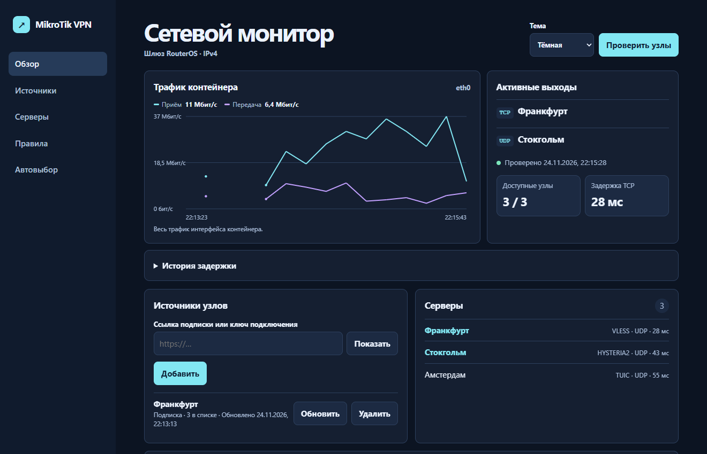

# MikroTik VPN

[Русский](README.md) · [Installation](#installation) · [Releases](https://github.com/TaTT04ek/MikrotikVPN/releases) · [Credits](#credits-and-sources)

MikroTik VPN is a RouterOS 7 container with a web dashboard and the Mihomo networking core. Import a subscription from your VPN provider, choose which traffic to tunnel, and monitor the active TCP and UDP exits, latency, and container traffic. The dashboard adapts to phone screens and supports light, dark, and system themes.



## Contents

- [Choose an image](#choose-an-image)
- [Enable containers in RouterOS](#enable-containers-in-routeros)
- [Install over HTTPS](#over-https) or [from a local archive](#from-a-local-archive)
- [Initial setup](#initial-setup)
- [How routing rules work](#how-routing-rules-work)
- [Telegram IP ranges](#telegram-ip-ranges)
- [Troubleshooting](#troubleshooting)
- [Subscription import problems](#subscription-import-problems)

## Choose an image

In the MikroTik terminal, run `/system/resource/print` and check the router model, RouterOS version, and `architecture-name`. For local installation, download the matching `.tar` archive, the `mikrotik-vpn-install.rsc` installer, and the `SHA256SUMS` file from the release page. When installing over HTTPS, the router downloads the matching image automatically. [v0.1.0 release files](https://github.com/TaTT04ek/MikrotikVPN/releases/tag/v0.1.0)

| Device or architecture | Archive |
| --- | --- |
| hAP ac³, hAP ac² | `mikrot-armv7.tar` |
| hAP ax³, RB5009UG+S+IN | `mikrot-arm64.tar` |
| hEX refresh (E50UG) | `mikrot-armv5.tar` |
| ARMv6 devices with container support | `mikrot-armv6.tar` |
| RouterOS CHR x86-64 | `mikrot-amd64.tar` |

## Enable containers in RouterOS

1. Open **Terminal** in WinBox and run `/system/package/print where name=container`. If the container package is installed and enabled, go to step 3.
2. Download **Extra Packages** for your RouterOS version and architecture. For the hAP ac³, choose `arm`. Extract the ZIP, upload `container-*.npk` to the top level of **Files**, run `/system/reboot`, and check the package again. [MikroTik downloads](https://mikrotik.com/download)
3. Run `/system/device-mode/print`. If the output shows `container: no`, run `/system/device-mode/update container=yes` and confirm the change within five minutes as instructed by the terminal. For CHR, power off the virtual machine and start it again. After startup, check that the output shows `container: yes`. [MikroTik device mode documentation](https://manual.mikrotik.com/docs/system-information-and-utilities/device-mode/)
4. Connect storage and verify it with `/disk/print detail`. An ext4-formatted USB drive works for the hAP ac³. Allow about 200 MiB of free space to store and extract the image. [MikroTik container documentation](https://manual.mikrotik.com/docs/containers/)

## Installation

### Over HTTPS

Copy the entire block, including the braces, into a WinBox or SSH terminal. The installer downloads the `v0.1.0` release files from GitHub Pages.

```routeros
{
    :local releaseUrl "https://tatt04ek.github.io/MikrotikVPN/v0.1.0"
    :local installerFile ("mikrotik-vpn-" . [:rndstr length=8] . ".rsc")
    :global mikrotikVpnReleaseBase
    :onerror err in={
        /tool/fetch url=($releaseUrl . "/mikrotik-vpn-install.rsc") dst-path=$installerFile check-certificate=yes http-max-redirect-count=5
        :set mikrotikVpnReleaseBase $releaseUrl
        /import file-name=$installerFile
    } do={
        :set mikrotikVpnReleaseBase
        :do { /file/remove [/file/find where name=$installerFile] } on-error={}
        :error $err
    }
    /file/remove [/file/find where name=$installerFile]
}
```

At the archive prompt, press **Enter** to let the router select and download the image. The hAP ac³ uses `mikrot-armv7.tar`. [Direct installer link](https://tatt04ek.github.io/MikrotikVPN/v0.1.0/mikrotik-vpn-install.rsc)

### From a local archive

Upload `mikrotik-vpn-install.rsc` to the top level of **Files** and the `.tar` image to the mounted drive. Run the following command in an interactive WinBox or SSH terminal.

```routeros
/import file-name=mikrotik-vpn-install.rsc
```

The installer detects a suitable drive, suggests an archive, and prompts for settings. Press **Enter** to accept a suggested value. The default container subnet is `172.30.55.0/30`, with `172.30.55.1` for the router and `172.30.55.2` for the container. You can specify a different IPv4 CIDR that does not overlap existing routes. The default interface lists are `LAN` and `WAN`.

If the installer finds Wi-Fi ports on bridges in the trusted LAN list, it displays them. At **Apply panel routing rules to these Wi-Fi clients [y/N]**, enter `y` to apply dashboard rules to IPv4 traffic from every client on those ports, including devices that connect later. Press **Enter** to skip this step.

For this step, use the [installer from the `main` branch](routeros/mikrotik-vpn-install.rsc) with a local image archive. The HTTPS command above uses the published `v0.1.0` release.

You can also enter a client IPv4 address or subnet, including wired devices. For an initial test, enter a single address such as `192.168.88.50`. To install only the dashboard, skip Wi-Fi setup and leave the client field blank. Enter a dashboard password when prompted or press **Enter** to generate one.

## Initial setup

The dashboard displays its controls in Russian. The steps below use English translations of their labels.

1. From a trusted LAN, open the address shown by the installer. The default address is `http://172.30.55.2:8080`. Sign in as `admin` with the password set during installation.
2. Under **Node sources**, paste a subscription URL or a single connection key and click **Add**. Repeat for each source. Supported protocols include VLESS/REALITY, VMess, Trojan, Shadowsocks, Hysteria2, and TUIC. All sources together can contain up to 64 unique nodes. You can refresh each subscription separately or remove any source.
3. Click **Check nodes**. The gateway can select different servers for TCP and UDP. The dashboard shows latency and marks nodes that support UDP.
4. Add your first rule under **Routing → Add service → YouTube → Via VPN**. Keep **No match → Direct**, then click **Save settings**. From the same client device, test the service and check that direct connections still work.

The **Overview** screen shows the active exits and charts. The dashboard measures traffic on the container's network interface and latency through HTTP checks of the selected nodes. Charts collect samples while the dashboard is open. The browser remembers your theme preference.

### How routing rules work

- The container receives IPv4 traffic from the selected Wi-Fi ports and devices in the `mikrot-vpn-clients` address list. The dashboard rules determine the route for those connections.
- Rules are evaluated from top to bottom. The first match wins, based on the service, domain, destination IP, or client IP. Unmatched traffic uses the selected default route.
- YouTube, GitHub, and Discord have built-in domain sets. Open the **Domains** preview to see their contents. The YouTube set covers the website, video servers, images, and APIs.
- To associate IP addresses with domain names, enable the container DNS in the dashboard and configure the selected clients to use the container IP as their DNS server. The container returns real IP addresses. If the hostname is hidden and the client uses another resolver, use a destination IP or client rule for predictable matching.
- Automatic selection uses HTTP probe results and a configured latency threshold. For UDP, it also checks whether the node supports UDP. If there is no suitable node for a protocol, new connections use the direct route. IPv6 follows the existing RouterOS rules.

**Discord.** The built-in domain set is available, and VPN connections to Discord can be intermittent. We plan to improve Discord compatibility in future releases.

To add a device after installation, put its address in the RouterOS client list. If you left the client field blank during installation, enable the marking rules after adding the device.

```routeros
/ip/firewall/address-list/add list=mikrot-vpn-clients address=192.168.88.50
/ip/firewall/mangle/enable [find where comment="MikroTik VPN installer"]
```

Settings and subscription data are stored in `/data/state.json` inside the container, usually under `mikrot-data` on the selected drive. This file contains subscription and node details. Keep it private.

### Telegram IP ranges

In the dashboard, choose **Routing → Add service → Telegram → Via VPN**, then save your settings. The rule matches the destination IPv4 address against Telegram's ranges. Clients can keep using their current DNS resolver.

The container checks the official list every three hours. Under **Telegram CIDR**, click **Refresh CIDR** to check immediately or view the ranges and the last successful update. If the direct connection to the source fails, the container retries through the selected TCP VPN exit. A successful download replaces the entire previous list. If the update fails, the container keeps the last successfully fetched list or uses the built-in list on first run. [Official Telegram CIDR list](https://core.telegram.org/resources/cidr.txt)

## Troubleshooting

| Symptom | What to check |
| --- | --- |
| The installer reports that containers are disabled | Run `/system/package/print where name=container` and `/system/device-mode/print`. Check the package and confirm the device mode change. |
| The installer cannot find the drive or archive | Check that the drive is mounted with `/disk/print detail`. Verify the archive name and path in **Files**, free space, and architecture. |
| The dashboard does not open | Check the address from the installer and verify that the client is on the selected LAN. Then run `/container/print where name=mikrot-vpn` and `/log/print where topics~"container"`. |
| The subscription fails to load | See [subscription import problems](#subscription-import-problems). |
| The client uses the direct route | Check the client address with `/ip/firewall/address-list/print where list=mikrot-vpn-clients`, verify rule order and the active exit for the protocol, then open a new connection. |

To temporarily restore RouterOS routing for clients, disable the installer's marking rules. The dashboard remains available from the LAN.

```routeros
/ip/firewall/mangle/disable [find where comment="MikroTik VPN installer"]
```

When reporting an issue, include the device model, RouterOS version, architecture, installation method, and error message. Remove the dashboard password, subscription URL, and keys from anything you share.

### Subscription import problems

1. Use **Show** to verify the URL. An HTTP or HTTPS subscription URL must return a plain-text or Base64-encoded list of keys, or a Clash/Mihomo YAML configuration with a `proxies` section. If the server returns HTML, ask your provider for a direct import URL. If you have a single key with a prefix such as `vless://` or `ss://`, paste the complete key into the same field.
2. If the dashboard reports a DNS error, test only the hostname on the router. Replace `sub.example.com` with the hostname from your subscription link, excluding the path and token.

   ```routeros
   :put [:resolve "sub.example.com"]
   /container/print proplist=name,dns where name="mikrot-vpn"
   /ip/dns/print
   ```

   If the router resolves the hostname but the container still reports a DNS error, set the container to use the RouterOS DNS address on its VETH link. The default address is `172.30.55.1`. The RouterOS resolver must already accept client DNS requests (`allow-remote-requests: yes`). Before the blocking rule in the `input` chain, allow inbound TCP and UDP port `53` from `172.30.55.2` to `172.30.55.1` on `veth-mikrot`. Update the container setting and verify that the container is running again. For a custom subnet, use the addresses from your installation. [RouterOS DNS documentation](https://manual.mikrotik.com/docs/network-management/dns/)

   ```routeros
   /container/set [find where name="mikrot-vpn"] dns=172.30.55.1
   /container/print where name="mikrot-vpn"
   ```

   If the container stopped after changing the setting, start it in WinBox or use `/container/start [find where name="mikrot-vpn"]`. Retry the subscription import in the dashboard.

3. For TLS errors, check the router's clock and the subscription server's certificate. For HTTP `401`, `403`, or `404` responses or an HWID requirement, check subscription availability and restrictions with the provider. For timeouts, check the container's internet access through the WAN.

## Further reading

- [Detailed installation guide (Russian)](docs/installation.md)
- [Architecture (Russian)](docs/architecture.md)

## Credits and sources

- **nskforward** wrote the VLESS and Mihomo guide for MikroTik that served as the starting point for the RouterOS container gateway setup. [Original guide](https://gist.github.com/nskforward/d143f4adde26ddf92001b0a84bc4de19)
- **MetaCubeX** develops Mihomo, the networking core that runs inside the container. [Mihomo v1.19.32](https://github.com/MetaCubeX/mihomo/releases/tag/v1.19.32)
- **V2Fly and the domain-list-community contributors** maintain the domain lists used by the built-in service presets. [Source lists](https://github.com/v2fly/domain-list-community) · [List license](services/LICENSE)
