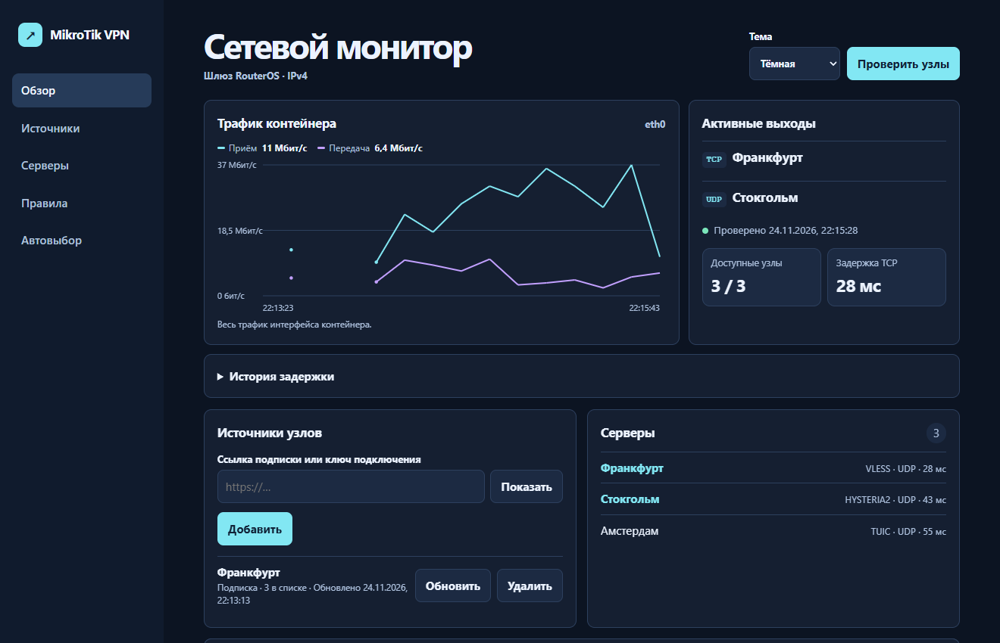

# MikroTik VPN

[English](README.en.md) · [Установка](#установка) · [Релизы](https://github.com/TaTT04ek/MikrotikVPN/releases) · [Авторы и источники](#авторы-и-источники)

MikroTik VPN — контейнер для RouterOS 7 с веб-панелью и сетевым ядром Mihomo. Подключите подписку своего VPN-провайдера, выберите трафик для туннеля и следите за активными TCP- и UDP-выходами, задержкой и трафиком контейнера. Панель адаптируется к экрану телефона и поддерживает светлую, тёмную и системную темы.



## Содержание

- [Выбор образа](#выбор-образа)
- [Включение контейнеров в RouterOS](#включение-контейнеров-в-routeros)
- [Установка по HTTPS](#по-https) и [из архива](#из-локального-архива)
- [Первый запуск и настройка](#первый-запуск-и-настройка)
- [Применение правил](#как-применяются-правила)
- [Диапазоны Telegram](#диапазоны-telegram)
- [Диагностика](#диагностика)
- [Если подписка не добавляется](#если-подписка-не-добавляется)

## Выбор образа

В терминале MikroTik выполните `/system/resource/print` и проверьте модель, версию и `architecture-name`. Для локальной установки скачайте подходящий `.tar`, установщик `mikrotik-vpn-install.rsc` и файл контрольных сумм `SHA256SUMS` со страницы релиза. При установке по HTTPS роутер загрузит нужный образ сам. [Файлы релиза v0.1.0](https://github.com/TaTT04ek/MikrotikVPN/releases/tag/v0.1.0)

| Устройство или архитектура | Архив |
| --- | --- |
| hAP ac³, hAP ac² | `mikrot-armv7.tar` |
| hAP ax³, RB5009UG+S+IN | `mikrot-arm64.tar` |
| hEX refresh (E50UG) | `mikrot-armv5.tar` |
| Устройства с контейнерами ARMv6 | `mikrot-armv6.tar` |
| RouterOS CHR x86-64 | `mikrot-amd64.tar` |

## Включение контейнеров в RouterOS

1. В WinBox откройте **Terminal** и проверьте наличие пакета `/system/package/print where name=container`. Если пакет уже установлен и включён, переходите к шагу 3.
2. Скачайте архив **Extra Packages** для той же версии RouterOS и архитектуры. Для hAP ac³ выберите `arm`. Распакуйте ZIP, загрузите файл `container-*.npk` в корень **Files**, выполните `/system/reboot` и повторно проверьте пакет. [Загрузки MikroTik](https://mikrotik.com/download)
3. Проверьте `/system/device-mode/print`. Если указано `container: no`, выполните `/system/device-mode/update container=yes` и подтвердите изменение в течение пяти минут способом, указанным в терминале. Для CHR остановите виртуальную машину и запустите её снова. После запуска убедитесь, что в выводе есть `container: yes`. [Руководство MikroTik по режиму устройства](https://manual.mikrotik.com/docs/system-information-and-utilities/device-mode/)
4. Подключите накопитель и проверьте его командой `/disk/print detail`. Для hAP ac³ подойдёт USB-накопитель с ext4. Ориентир для хранения и распаковки образа — примерно 200 МиБ свободного места. [Руководство MikroTik по контейнерам](https://manual.mikrotik.com/docs/containers/)

## Установка

### По HTTPS

Скопируйте весь блок вместе с фигурными скобками и вставьте в терминал WinBox или SSH. Установщик скачает файлы релиза `v0.1.0` с GitHub Pages.

```routeros
{
    :local releaseUrl "https://tatt04ek.github.io/MikrotikVPN/v0.1.0"
    :local installerFile ("mikrotik-vpn-" . [:rndstr length=8] . ".rsc")
    :global mikrotikVpnReleaseBase
    :onerror err in={
        /tool/fetch url=($releaseUrl . "/mikrotik-vpn-install.rsc") dst-path=$installerFile check-certificate=yes http-max-redirect-count=5
        :set mikrotikVpnReleaseBase $releaseUrl
        /import file-name=$installerFile
    } do={
        :set mikrotikVpnReleaseBase
        :do { /file/remove [/file/find where name=$installerFile] } on-error={}
        :error $err
    }
    /file/remove [/file/find where name=$installerFile]
}
```

В поле архива нажмите **Enter**, чтобы роутер сам выбрал и скачал образ. Для hAP ac³ это `mikrot-armv7.tar`. [Прямая ссылка на установщик](https://tatt04ek.github.io/MikrotikVPN/v0.1.0/mikrotik-vpn-install.rsc)

### Из локального архива

Загрузите `mikrotik-vpn-install.rsc` в корень **Files**, образ `.tar` — на смонтированный накопитель. Выполните команду в интерактивном терминале WinBox или SSH.

```routeros
/import file-name=mikrotik-vpn-install.rsc
```

Установщик найдёт подходящий диск, предложит архив и спросит параметры. **Enter** принимает предложенное значение. По умолчанию сеть контейнера — `172.30.55.0/30`, роутер в ней получает `172.30.55.1`, контейнер — `172.30.55.2`. Можно задать другой IPv4 CIDR, который не пересекается с существующими маршрутами. Для списков интерфейсов предлагаются `LAN` и `WAN`.

Если установщик найдёт Wi‑Fi-порты на мостах из доверенного списка LAN, он перечислит их. В ответ на **Apply panel routing rules to these Wi-Fi clients [y/N]** введите `y`, чтобы правила панели применялись к IPv4-трафику всех клиентов этих портов, включая новые устройства. **Enter** пропускает этот шаг.

Для этого шага используйте [установщик из ветки `main`](routeros/mikrotik-vpn-install.rsc) с локальным архивом образа. Команда установки по HTTPS выше использует опубликованный релиз `v0.1.0`.

Можно отдельно указать IPv4-адрес или подсеть клиента, в том числе проводного. Для пробного запуска подойдёт один адрес, например `192.168.88.50`. Чтобы установить только панель, пропустите настройку Wi‑Fi и оставьте поле клиента пустым. Установщик попросит пароль для панели или сгенерирует его, если нажать Enter.

## Первый запуск и настройка

1. Откройте из доверенной локальной сети адрес, который показал установщик. Для сети по умолчанию это `http://172.30.55.2:8080`. Войдите как `admin` с паролем, заданным при установке.
2. В разделе **Подписка** вставьте URL и нажмите **Загрузить**. Для Remnawave можно использовать обычную ссылку подписки. Поддерживаются списки ссылок в тексте или Base64, а также Clash/Mihomo YAML с разделом `proxies`. Кнопка **Показать** позволяет сверить URL, который по умолчанию скрыт из-за токена доступа. Поддерживаются VLESS/REALITY, VMess, Trojan, Shadowsocks, Hysteria2 и TUIC. Лимит подписки — 64 уникальных поддерживаемых узла.
3. Нажмите **Проверить узлы**. У выбранных выходов TCP и UDP могут быть разные серверы. Панель показывает задержку, а для узлов с поддержкой UDP — пометку UDP.
4. Добавьте первое правило. Например, **Маршрутизация → Добавить сервис → YouTube → Через VPN**. Оставьте **Без совпадений → Напрямую**, затем нажмите **Сохранить настройки**. Проверьте нужный сервис и прямой маршрут с того же клиентского устройства.

На экране **Обзор** видны активные выходы и графики. Трафик измеряется на сетевом интерфейсе контейнера. Задержка берётся из HTTP-проверок выбранных узлов. Графики копят замеры, пока открыта панель. Выбор темы сохраняется в браузере.

### Как применяются правила

- Контейнер получает IPv4-трафик с выбранных Wi‑Fi-портов и от устройств из списка `mikrot-vpn-clients`. Панель определяет, куда отправить этот трафик.
- Правила идут сверху вниз. Срабатывает первое совпадение по сервису, домену, IP назначения или IP клиента. Если совпадений нет, применяется выбранный маршрут по умолчанию.
- Для YouTube, GitHub и Discord есть встроенные наборы доменов. Состав набора виден в предпросмотре **Домены**. Для YouTube он включает сайт, видеосерверы, изображения и API.
- Для сопоставления IP с доменами можно включить DNS контейнера в панели и указать его IP как DNS у выбранных клиентов. Контейнер возвращает реальные IP. Если имя скрыто и клиент пользуется другим DNS, для однозначного выбора используйте правило по IP или устройству.
- Автовыбор использует результаты HTTP-проверок и заданный порог задержки. Для UDP учитывается поддержка UDP узлом. Если подходящих узлов для данного протокола нет, новые соединения идут напрямую. IPv6 идёт по действующим правилам RouterOS.

**Discord.** Соединение через VPN может работать с перебоями. Совместимость встроенного пресета с Discord будем улучшать в следующих версиях.

Чтобы добавить устройство после установки, укажите его адрес в списке клиентов RouterOS. Если при установке поле клиента было пустым, после добавления устройства включите правила маркировки.

```routeros
/ip/firewall/address-list/add list=mikrot-vpn-clients address=192.168.88.50
/ip/firewall/mangle/enable [find where comment="MikroTik VPN installer"]
```

Настройки и подписка хранятся в `/data/state.json` внутри контейнера, обычно в каталоге `mikrot-data` на выбранном накопителе. В файле есть данные подписки и узлов. Храните его как конфиденциальный файл.

### Диапазоны Telegram

В панели выберите **Маршрутизация → Добавить сервис → Telegram → Через VPN** и сохраните настройки. Правило сопоставляет IPv4-адрес назначения с диапазонами Telegram. Для него не требуется включать DNS контейнера на клиентских устройствах.

Контейнер проверяет официальный список каждые три часа. В разделе **CIDR Telegram** можно запустить проверку кнопкой **Обновить CIDR**, посмотреть диапазоны и время последнего успешного обновления. Если прямое подключение к источнику не удалось, контейнер повторяет запрос через выбранный TCP-выход VPN. Новый список целиком заменяет предыдущий. При ошибке продолжает действовать последний успешно полученный список или встроенный список для первого запуска. [Официальный список Telegram](https://core.telegram.org/resources/cidr.txt)

## Диагностика

| Что происходит | Что проверить |
| --- | --- |
| Установщик сообщает, что контейнеры выключены | Выполните `/system/package/print where name=container` и `/system/device-mode/print`. Проверьте пакет и подтверждение режима. |
| Установщик не видит диск или архив | Проверьте монтирование через `/disk/print detail`, имя и путь архива в **Files**, место на диске и архитектуру. |
| Панель не открывается | Уточните адрес из вывода установщика, убедитесь, что клиент в выбранной LAN, затем выполните `/container/print where name=mikrot-vpn` и `/log/print where topics~"container"`. |
| Подписка не загружается | Сверьтесь с [диагностикой подписки](#если-подписка-не-добавляется). |
| Клиент идёт напрямую | Проверьте его адрес в `/ip/firewall/address-list/print where list=mikrot-vpn-clients`, порядок правил панели и активный выход для нужного протокола. Откройте новое соединение после изменений. |

Чтобы временно вернуть клиентам маршрутизацию RouterOS, отключите правила маркировки установщика. Панель останется доступной из LAN.

```routeros
/ip/firewall/mangle/disable [find where comment="MikroTik VPN installer"]
```

Если сообщаете о проблеме, приложите модель, версию RouterOS, архитектуру, способ установки и сообщение об ошибке. Уберите из материалов пароль панели, ссылку подписки и ключи.

### Если подписка не добавляется

1. Сверьте URL через кнопку **Показать**. Вставляйте ссылку подписки клиента, которую выдал провайдер. Для Remnawave подходит обычная ссылка подписки. Если панель получает HTML вместо списка узлов, убедитесь, что скопировали ссылку подписки из карточки пользователя. [Форматы Remnawave](https://docs.rw/learn-en/templates/)
2. Если панель сообщает об ошибке DNS, проверьте разрешение **только домена** на роутере. Замените `sub.example.com` на домен из ссылки без пути и токена.

   ```routeros
   :put [:resolve "sub.example.com"]
   /container/print proplist=name,dns where name="mikrot-vpn"
   /ip/dns/print
   ```

   Если домен разрешается на роутере, но контейнер всё ещё сообщает об ошибке DNS, укажите ему DNS-адрес RouterOS через его VETH. Для стандартной установки это `172.30.55.1`. Резолвер роутера должен уже принимать клиентские запросы (`allow-remote-requests: yes`). В файрволе разрешите входящие TCP и UDP на порт `53` от `172.30.55.2` к `172.30.55.1` через `veth-mikrot`, выше запрещающего правила `input`. Затем обновите параметр контейнера и убедитесь, что он снова запущен. Для собственной подсети подставьте адреса из установки. [DNS в RouterOS](https://manual.mikrotik.com/docs/network-management/dns/)

   ```routeros
   /container/set [find where name="mikrot-vpn"] dns=172.30.55.1
   /container/print where name="mikrot-vpn"
   ```

   Если контейнер остановился после изменения параметра, запустите его через WinBox или командой `/container/start [find where name="mikrot-vpn"]`. Повторите загрузку из панели.

3. При ошибке TLS проверьте дату и время роутера и сертификат сервера подписки. При HTTP `401`, `403`, `404` или требовании HWID проверьте доступность подписки и её ограничения у провайдера. При тайм-ауте проверьте выход контейнера в интернет через WAN.

## Подробнее

- [Подробная инструкция по установке](docs/installation.md)
- [Архитектура](docs/architecture.md)

## Авторы и источники

- **nskforward** — автор гайда по VLESS и Mihomo на MikroTik, который послужил отправной точкой для настройки контейнерного шлюза в RouterOS. [Оригинальный гайд](https://gist.github.com/nskforward/d143f4adde26ddf92001b0a84bc4de19)
- **MetaCubeX** — разработчики сетевого ядра Mihomo, которое запускается внутри контейнера. [Mihomo v1.19.32](https://github.com/MetaCubeX/mihomo/releases/tag/v1.19.32)
- **V2Fly и участники domain-list-community** — источник доменных списков для встроенных пресетов. [Исходные списки](https://github.com/v2fly/domain-list-community) · [Лицензия списков](services/LICENSE)
